```text
7tr9
📌Địa chỉ: 64 Cửu Long, P2, Quận Tân Bình

📌Tòa nhà thang bộ 3 lầu, nhà xe, ra vào vân tay, camera 24/24, 
📌Dạng phòng: Duplex và Studio

📌Nội thất: Đầy đủ 

📌 Chính sách và quy định của tòa nhà:
+ Điện: 4.000đ/kw
+ Nước 100k/người
+ Phí dịch vụ (wifi, rác, vệ sinh chung, giặt sấy) : 200k/phòng
+ Xe: Free - 2xe
+ Số người ở: tối đa 4 người (phòng lớn)
+ Nuôi thú cưng: được có cam kết dưới 5kg
```

## Hình ảnh

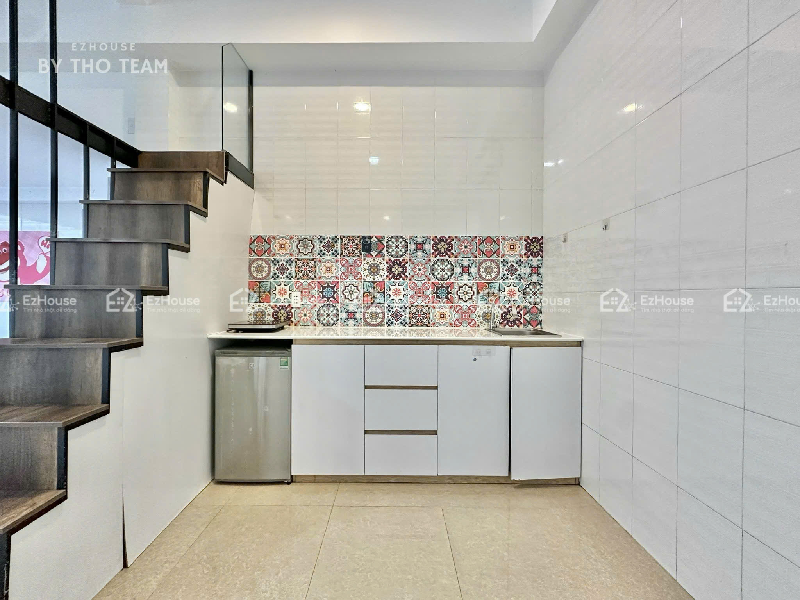

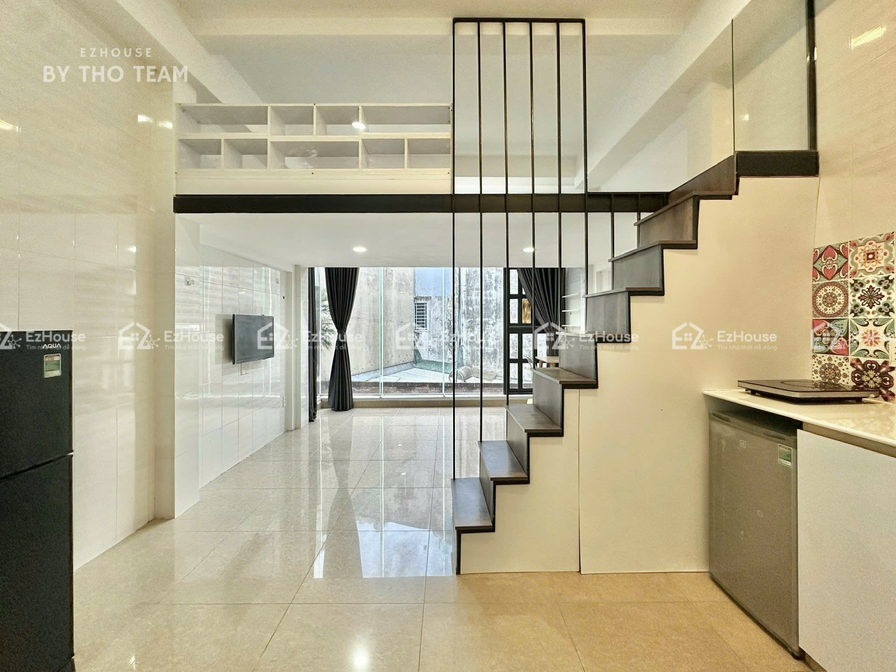

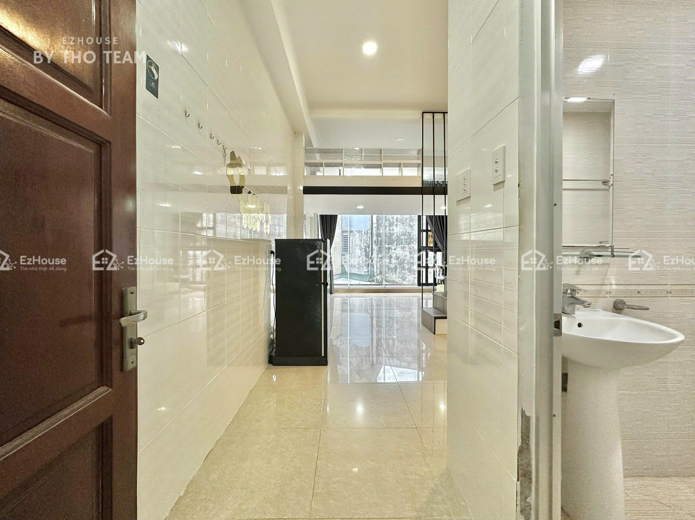

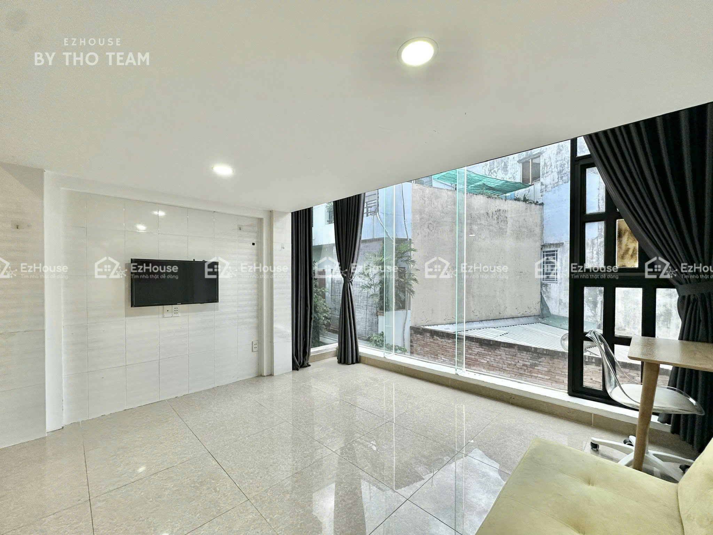

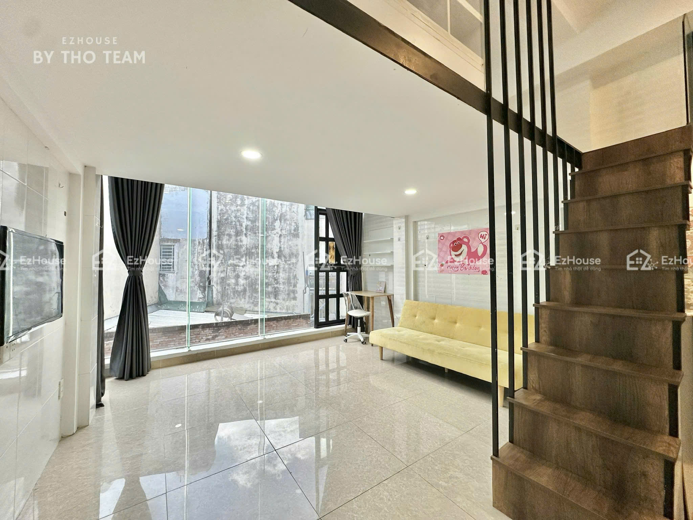

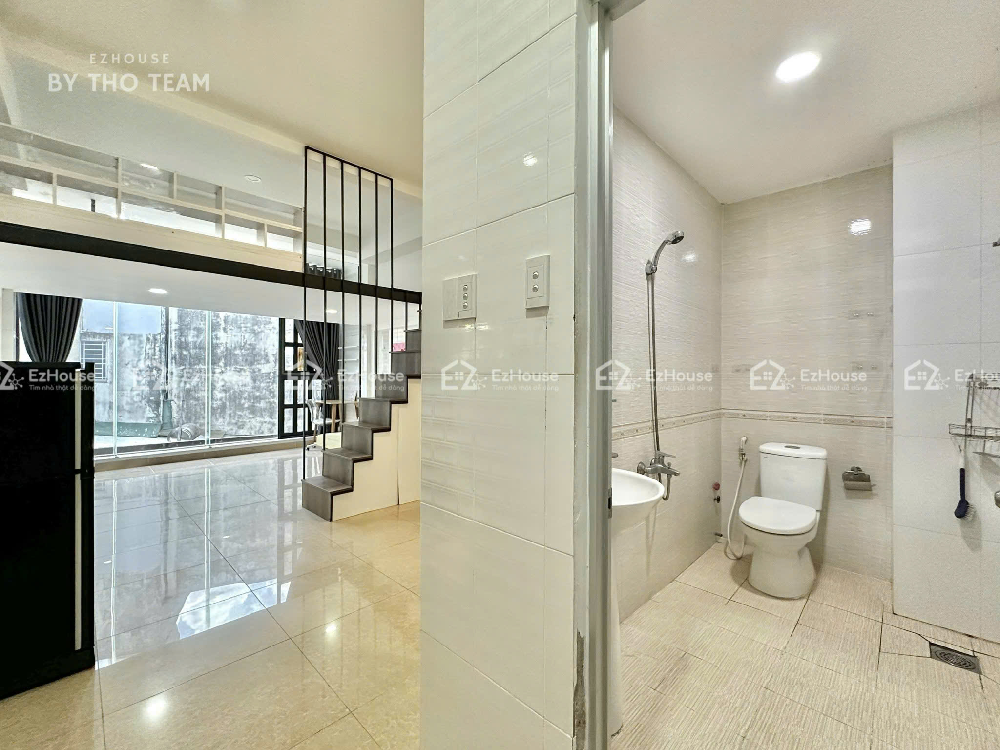

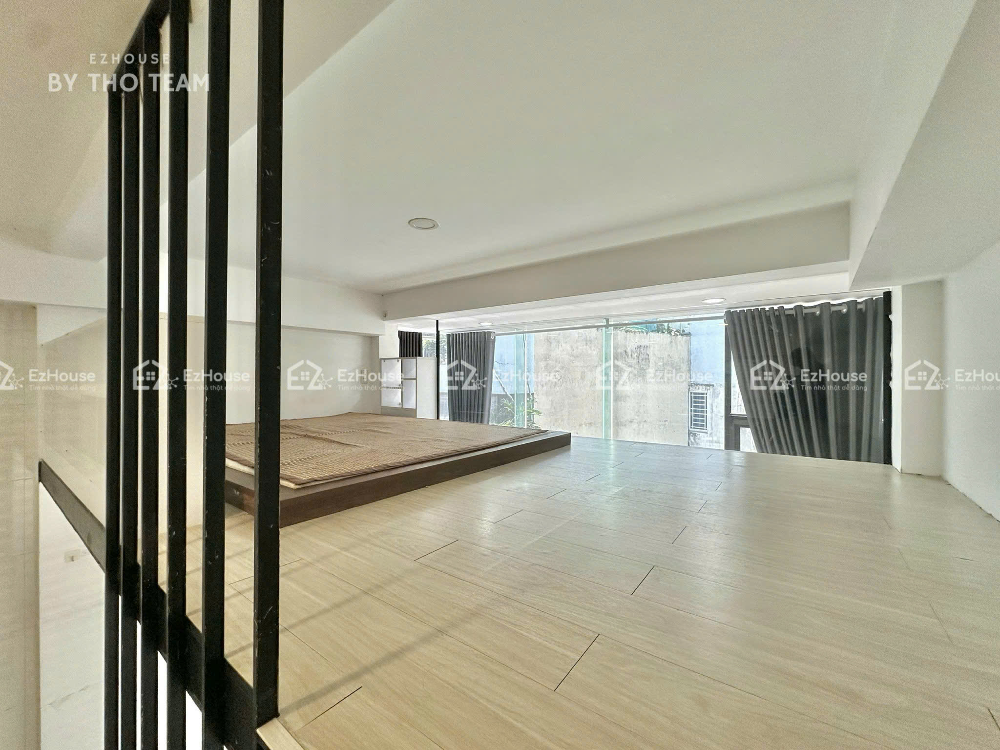

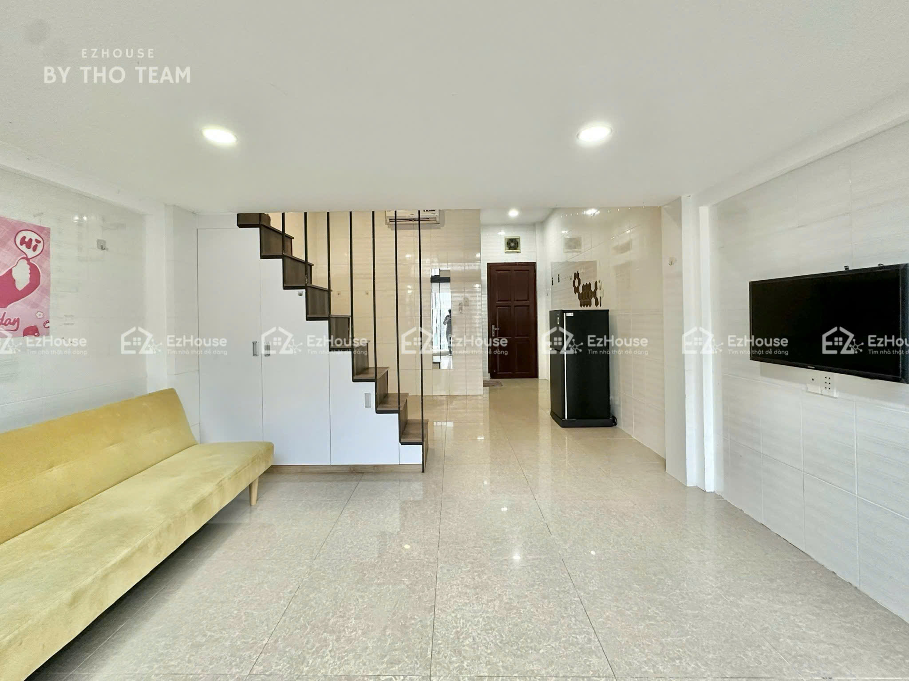

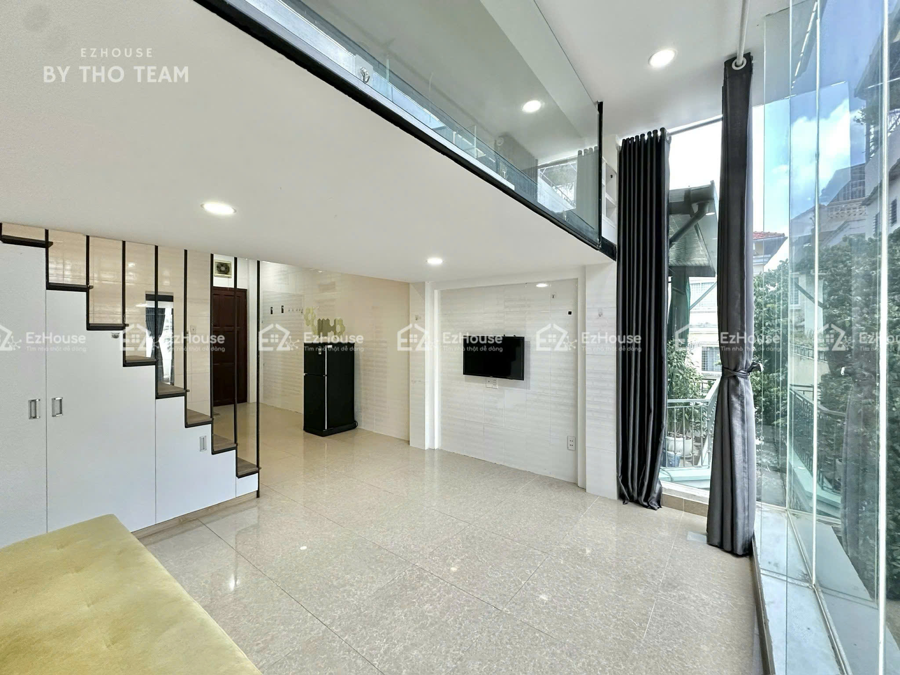

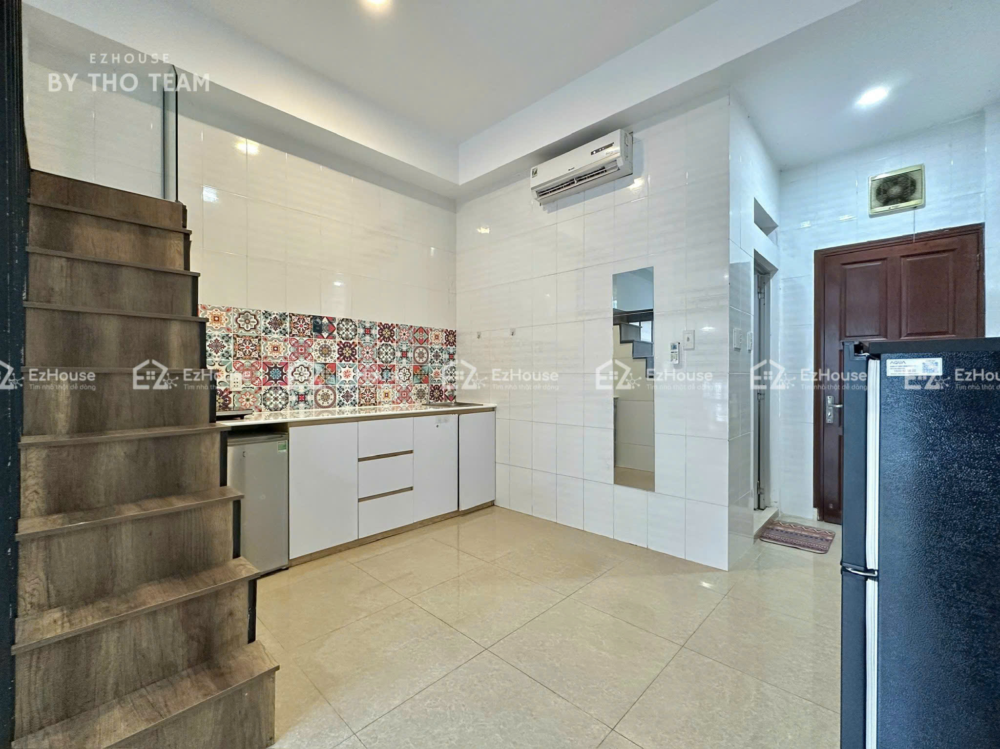

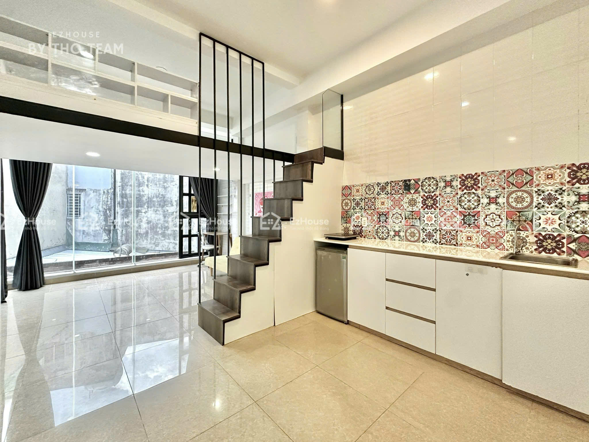

